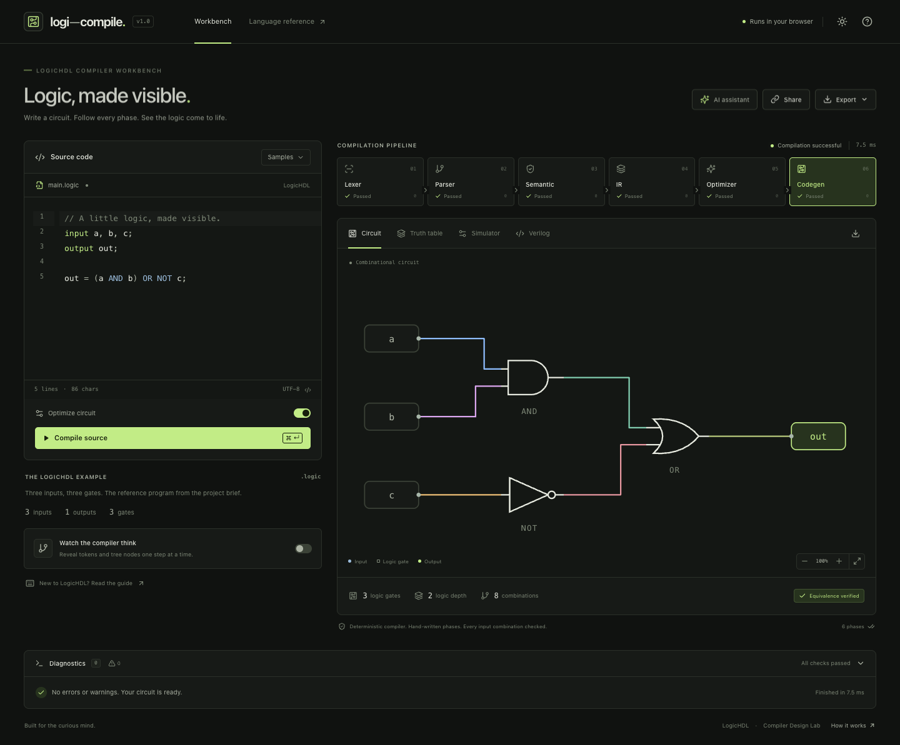
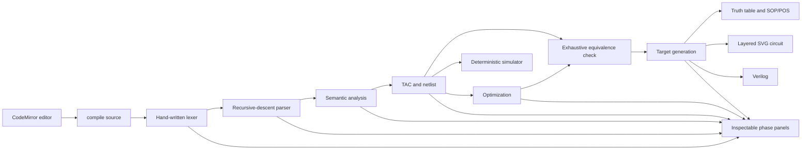

# Logi-Compile

**A real compiler for combinational logic, with every phase visible.** Write LogicHDL, inspect its tokens and trees, trace signal dependencies, compare optimized hardware, and simulate the resulting circuit. The compiler runs entirely in the browser and needs no server or API key.



## Run locally

Use Node.js 22 or newer and npm. From a clean clone:

```sh
npm install
npm run dev
```

Open the local URL printed by Vite, normally `http://127.0.0.1:5173`.

```sh
npm test                 # full Vitest suite, once
npm run test:watch       # watch compiler tests while editing
npm run build            # TypeScript checking and production build
npm run preview          # serve the production build
npm run check:milestone  # tests, build, and development-server HTTP smoke check
npm run benchmark        # measured 10-input full compiler pipeline
npm run test:browser     # optional real-browser QA; keep npm run dev running
```

Build output is in `dist/`. It is a static application and can be served by a static host. Compiler compilation and simulation require no network access. Optional AI assistance requires a network connection and an API key.

### Reproduce the browser checks

Keep `npm run dev` running, then run `npm run test:browser` in another terminal. The optional Playwright suite uses installed Google Chrome on macOS when available, otherwise Playwright Chromium. If neither browser is installed, install the test browser once:

```sh
npx playwright install chromium
npm run test:browser
```

Set `LOGI_CHROME_PATH` to use another Chrome/Chromium executable, or `LOGI_URL` if the app runs on a different local port. For example, `LOGI_URL=http://127.0.0.1:5174 npm run test:browser`. The suite checks phase interactions, source highlighting, every sample, simulator values, all six downloads, share links, themes, teaching controls and responsive widths. It writes fresh screenshots to `docs/screenshots/`, including the workbench image above. This browser suite is additional to `npm test` and requires a running local app and a browser executable.

## Try the reference program

```text
input a, b, c;
output out;

out = (a AND b) OR NOT c;
```

With inputs in declaration order, the first input is the most significant bit:

| a | b | c | out |
| --- | --- | --- | --- |
| 0 | 0 | 0 | 1 |
| 0 | 0 | 1 | 0 |
| 0 | 1 | 0 | 1 |
| 0 | 1 | 1 | 0 |
| 1 | 0 | 0 | 1 |
| 1 | 0 | 1 | 0 |
| 1 | 1 | 0 | 1 |
| 1 | 1 | 1 | 1 |

For `001`, `a AND b` is 0 and `NOT c` is 0, so the output is **0**. The canonical forms are `Σm(0,2,4,6,7)` and `ΠM(1,3,5)`. The unoptimized circuit has three gates and depth two:

```text
t1  = AND a, b
t2  = NOT c
out = OR t1, t2
```

## Use the workbench

- **Write or choose a sample.** The CodeMirror editor supplies line numbers, LogicHDL highlighting, diagnostic underlines and hover messages. Compilation follows edits after a 250 ms debounce; Compile runs immediately.
- **Inspect the pipeline.** Lexer, Parser, Semantic, IR, Optimizer and Codegen show success, warnings, error counts, or the earlier phase that blocks them. Earlier results remain inspectable after an error.
- **Follow the source.** Select a token, tree node, diagnostic or optimization rule to highlight its source span. Editor selections relate back to tokens. TAC rows and circuit gates share gate IDs.
- **Teach one step at a time.** Step-through mode reveals tokens and concrete parse-tree nodes incrementally. Play, pause, step and speed controls change the presentation, while the underlying compiler result stays deterministic.
- **Compare hardware.** The Optimizer panel shows each real rewrite, before/after circuits, gate count, logic depth, and the exhaustive equivalence result. Turn optimization off to inspect the original target.
- **Simulate.** Toggle inputs in Simulator. Green means 1, grey means 0; gate outputs and wires update, and the corresponding truth-table row is highlighted.
- **Take the result with you.** Export LogicHDL source, all phase data as JSON, circuit SVG/PNG, truth-table CSV, or Verilog. Copy the Verilog or a URL hash share link. Source in a share link is encoded, so anyone holding the link can read it.
- **Adjust the workspace.** Switch between dark and light themes, or open How it works for a short explanation of the compiler phases.

## LogicHDL language reference

Signals are single-bit values. Declare external inputs, observed outputs, and intermediate wires. Every wire and output must have exactly one driver. Inputs cannot be assigned in a program. Assignments may precede their declarations or other assignments because execution order does not define combinational hardware; the compiler derives dependency order.

```text
// Half adder
input a, b;
output sum, carry;
sum = a XOR b;
carry = a AND b;
```

| Construct | Syntax |
| --- | --- |
| Declarations | `input a, b;` · `output y;` · `wire partial;` |
| Assignment | `y = expression;` |
| Identifiers | `[A-Za-z_][A-Za-z0-9_]*`; case-sensitive |
| Literals | `0` and `1` |
| Comments | `// line` · `# line` · `/* block */` |
| Unary NOT | `NOT a` · `!a` · `~a` |
| AND / NAND | `a AND b` · `a & b` · `a NAND b` |
| XOR / XNOR | `a XOR b` · `a ^ b` · `a XNOR b` |
| OR / NOR | `a OR b` · `a \| b` · `a NOR b` |
| Grouping | `(a OR b) AND c` |

Keywords are case-insensitive and reserved as names. Precedence, highest first: **NOT → AND/NAND → XOR/XNOR → OR/NOR**. Binary operators associate left, including NAND and NOR. Thus `a NAND b NAND c` means `(a NAND b) NAND c`; it must not be reassociated.

There are no clocks, delays, registers, vectors, implicit signals, loops, or stateful feedback. A feedback latch is a semantic cycle error. See [formal grammar and diagnostic catalog](docs/GRAMMAR.md).

### Samples and reproducible failures

The Samples menu includes twelve complete circuits: the reference program, half adder, full adder, 2:1 mux, 4:1 mux, XOR from NAND gates, three-input majority, two-bit comparator, parity generator, a seven-segment decoder bit, an SR-style feed-forward cascade, and an optimization playground.

The seven-segment example lights segment a for BCD digits 0, 2, 3, 5, 6, 7, 8 and 9; invalid BCD inputs produce 0. The cascade takes `q_in` as an external input and computes reset-dominant next-state logic. It contains no feedback.

Broken samples reproduce illegal characters, malformed numbers, digit-leading identifiers, unclosed comments, missing/extra parentheses, empty expressions, missing operands/assignment signs/semicolons, consecutive operators, nameless declarations, stray tokens, unexpected EOF, undefined signals, multiple drivers, input assignment, duplicate declarations, reserved names, cycles, undriven signals and too many inputs.

## Architecture



`src/compiler/` is pure TypeScript. It imports neither React nor browser DOM APIs, uses no parser generator or graph-layout package, and can be imported by a CLI or another application. React, CodeMirror, browser downloads and optional API requests live outside the compiler.

| Path | Responsibility |
| --- | --- |
| `src/compiler/types.ts` | Tokens, spans, AST, concrete tree, diagnostics and all phase contracts |
| `src/compiler/lexer.ts` | Bounded scanner, comments, source locations and recovering lexical diagnostics |
| `src/compiler/parser.ts` | Recursive descent, precedence, AST, concrete tree and panic recovery |
| `src/compiler/semantic.ts` | Symbols, driver rules, dependency graph, cycles, topological order and warnings |
| `src/compiler/ir.ts` | Topological three-address code, gates, aliases, gate count and depth |
| `src/compiler/evaluator.ts` | Dependency-scheduled netlist evaluation and exhaustive equivalence checking |
| `src/compiler/optimizer.ts` | Boolean rewrites, CSE, dead-code removal and rewrite evidence |
| `src/compiler/codegen.ts` | Truth tables, canonical forms, CSV and Verilog |
| `src/compiler/layout.ts` | Hand-written layered layout and standalone gate SVG |
| `src/compiler/index.ts` | Public `compile()` entry point and phase blocking |
| `src/components/` | Editor, trees, diagrams and phase visualizations |
| `src/data/samples.ts` | Working circuits and diagnostic demonstrations |

Read [ARCHITECTURE.md](docs/ARCHITECTURE.md) for contracts, algorithms and complexity.

## Correctness, limits and tests

Vitest checks every lexer token/error, parser precedence and recovery, semantic codes and locations, topological TAC, all optimizer rules, all twelve working samples against independently written reference equations, SVG layout, canonical forms, Verilog naming, malformed source and bounded extreme inputs. A seeded property test generates **200 expressions** and compares every possible input combination before/after optimization. The full suite also checks the reference truth table directly. Current test totals and measured performance are recorded in [TEST_REPORT.md](docs/TEST_REPORT.md).

The compiler reports a diagnostic instead of attempting an unbounded truth table or recursive computation:

| Limit | Value |
| --- | --- |
| Source characters | 10,000 |
| Tokens before EOF | 4,000 |
| Declarations plus assignments | 256 |
| Expression/parenthesis nesting | 96 levels |
| Declared inputs | 12, including unused inputs |
| Truth-table/equivalence rows | 4,096 |
| Gates | 1,024 |

The optimizer checks **all output values on all input combinations**, preserving declared input/output order. A mismatch returns the input assignment that exposed it, produces `OPT001`, and blocks optimized target generation. With optimization disabled, targets use the original IR. Semantic tautology warnings recognize constant and structural Boolean patterns; they are hints rather than a complete Boolean minimizer.

## Optional AI assistance

The deterministic compiler works fully with AI disabled. AI features are user-triggered: error explanation sends the selected diagnostic and source; generation sends the natural-language description. Use the assistant drawer to explain a diagnostic or turn a requirement into LogicHDL. Generated programs must pass the real compiler; an invalid generation is retried once with the diagnostics, and invalid source is never silently accepted.

A key may be entered for the current session or supplied as `VITE_ANTHROPIC_API_KEY` in a local `.env` file. User-entered keys stay in memory and are cleared when the assistant drawer closes; `.env` and related local secrets are ignored by Git. Vite variables are embedded in browser assets, so **a production deployment should proxy Anthropic requests through a server and keep its key there**. The model field is editable and defaults to `claude-sonnet-5-5`; choose a compatible model available to your account. The default model ID follows [Anthropic's Sonnet model documentation](https://platform.claude.com/docs/en/models/sonnet-5-5/overview).

The optional **Workspace ID** field is also held only in memory. Leave it blank for a key scoped to one workspace. For an unscoped personal/service key, enter the target workspace ID; the client sends it as `anthropic-workspace-id`. Find the ID on the Claude Console Workspaces page, as described in [Anthropic's authentication documentation](https://platform.claude.com/docs/en/manage-claude/authentication#select-a-workspace). This project does not require or commit an API key, and no paid live API request is part of its verification suite.

The AI-assisted development record, task prompts and verification evidence are in [AI_USAGE_LOG.md](docs/AI_USAGE_LOG.md), [PROMPTS.md](docs/PROMPTS.md) and [MASTER_PROMPT.md](docs/MASTER_PROMPT.md). AI-generated code has automated and agent review; the project does not claim independent human verification.

## Grading rubric

| Rubric criterion | Where it is demonstrated |
| --- | --- |
| **1. Complexity and relevance** | A six-phase combinational HDL compiler; forward references and dependency ordering; seven Boolean operators; multiple outputs; custom circuit layout; simulation; practical adder, mux, comparator and decoder examples. |
| **2. Correct target and intermediate code** | Source-spanned AST, topological TAC/netlist, deterministic evaluator, canonical truth-table indexing, SOP/POS, valid renamed Verilog identifiers, real Boolean rewrites, exhaustive equivalence and reference-output tests. |
| **3. Lexical, syntax and semantic edge cases** | Recovering scanner/parser, unified diagnostic contract, exact location tests, both duplicate-driver locations, cycle paths, constant/unused warnings, blocked-phase states, size/depth limits and garbage fuzz tests. |
| **4. Interactive phase visualization** | Editor diagnostics and cross-highlighting; token table; concrete tree/AST toggle; sortable symbols/dependency graph; TAC/netlist; optimizer evidence and circuit comparison; output tabs; simulator; teaching stepper; exports and help. |

Every feature has a rubric purpose:

| Feature group | Criterion(s) | Evidence |
| --- | --- | --- |
| TypeScript/Vite/React/Tailwind shell; pure compiler module | 1, 2 | Build commands, architecture contracts and compiler unit tests |
| Keyword/symbol aliases, literal scanning and all comment forms | 1, 2, 3 | Lexer panel and lexical tests |
| Precedence, associativity, concrete grammar tree and AST | 1, 2, 4 | Parser panel, snapshots and precedence tests |
| Lexical recovery and semicolon panic recovery | 3, 4 | Broken samples, partial results and diagnostics |
| Symbol collection, single drivers and declaration-independent execution | 1, 2, 3 | Semantic table, driver diagnostics and topo tests |
| Dependency graph, cycle paths, undefined/undriven/input/duplicate-name checks | 1, 3, 4 | Semantic graph and reproducible broken samples |
| Input/wire usage and constant/tautology/contradiction warnings | 2, 3, 4 | Semantic diagnostics and warning tests |
| TAC, temporary-name collision handling and netlist | 2, 4 | IR panel and reference TAC tests |
| Folding, identity/annihilator, idempotence/complement, double negation | 1, 2, 4 | Optimizer rewrite log and per-law tests |
| Common subexpressions and dead-code removal | 1, 2, 4 | Playground sample and before/after diagrams/metrics |
| Exhaustive equivalence and optimizer toggle/failure state | 2, 3, 4 | Optimizer badge, counterexample test and original target mode |
| Truth table, declaration order, row highlighting and canonical forms | 2, 4 | Output table, live row and all-sample reference checks |
| Custom layered SVG, conventional gates, inversion bubbles and net colors | 1, 2, 4 | Circuit target, geometry/orthogonality tests and SVG export |
| Input switches, animated live nets and gate outputs | 2, 4 | Simulator and shared evaluator |
| Verilog, JSON, CSV, SVG and PNG exports; copy controls | 2, 4 | Export controls and generated target tests |
| Debounced live compilation and explicit Compile | 4 | Source editor and phase statuses |
| Tokens/source/tree/TAC/gate/diagnostic cross-highlighting | 4 | Selectable real phase data sharing source spans and gate IDs |
| Play/pause/step/speed teaching controls | 4 | Step-through token and parse-tree presentation |
| Working and deliberately broken samples | 1, 2, 3, 4 | Samples menu and deterministic test fixtures |
| Dark/light themes, responsive layout, share links and help drawer | 4 | Workbench controls, mobile layout and encoded source links |
| Optional error explanation and validated English-to-HDL | 1, 3, 4 | AI drawer; deterministic validation and retry boundary |
| Source/depth/size limits and random-garbage robustness | 2, 3 | Fuzz tests and clear bound diagnostics |
| AI usage log, prompts, demo and verification report | 1, 2, 3, 4 | `docs/` evidence and viva walkthrough |

## Documentation and viva

- [GRAMMAR.md](docs/GRAMMAR.md): exact syntax, precedence, semantics and diagnostic codes.
- [ARCHITECTURE.md](docs/ARCHITECTURE.md): pipeline, structured data, layout and correctness boundaries.
- [TEST_REPORT.md](docs/TEST_REPORT.md): test outcomes, fuzz coverage and performance.
- [DEMO_SCRIPT.md](docs/DEMO_SCRIPT.md): a five-minute live demonstration.
- [DECISIONS.md](docs/DECISIONS.md): implementation choices and scope limits.

The remaining practical limits are intentional: a single-bit combinational language, bounded exhaustive truth tables, heuristic gate placement rather than physical wire routing, and local Boolean simplification rather than globally minimal synthesis. Browser PNG export scales large diagrams to a maximum 4,096-pixel dimension. Shared URLs carry source directly in the hash and may reach browser or messaging-app URL limits for large designs.
