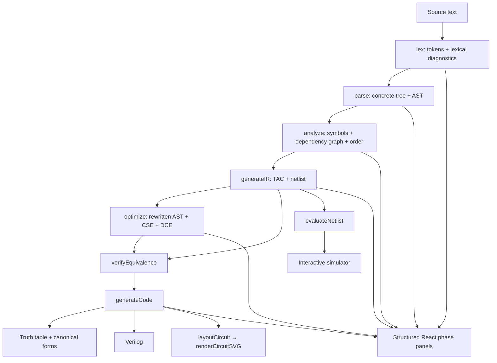

# Compiler and workbench architecture

## Boundaries

`src/compiler/` contains the hand-written compiler, evaluator, target generation and SVG serialization as pure TypeScript. It has no React, DOM, editor, API-client, parser-generator or graph-layout imports. Browser-only behavior is implemented by React components and helpers outside that directory. The main entry point is `compile(source, { optimize?: boolean })` in `src/compiler/index.ts`.



The orchestrator runs phases in order, times each phase and stores earlier results even on failure. An error blocks all subsequent phases and records `blockedBy`. Warnings leave the pipeline running. With optimization disabled, the optimizer stage is `disabled` and code generation consumes the original IR. Defensive exception handling converts unexpected failures into diagnostics at the phase boundary.

## Public data contracts

The authoritative types are in `src/compiler/types.ts`. Values are ordinary serializable objects and arrays, so the JSON export can include the complete compilation result.

```ts
interface Span {
  offset: number;       // zero-based character offset
  line: number;         // one-based
  column: number;       // one-based
  length: number;
}

interface Token extends Span {
  type: TokenType;
  lexeme: string;       // original spelling, even for keyword/symbol aliases
}

interface Diagnostic extends Span {
  phase: 'lexer' | 'parser' | 'semantic' | 'ir' | 'optimizer' | 'codegen';
  severity: 'error' | 'warning' | 'info';
  code: string;
  message: string;
  hint: string;
  related?: { message: string; span: Span }[];
}
```

The AST is a discriminated union. Expressions are `Identifier`, `Literal`, `Unary` or `Binary`; a `Program` contains `Declaration` and `Assignment` items. Each node carries a source span. Binary nodes retain source grouping; the AST does not treat NAND/NOR chains as associative.

The concrete `ParseNode` adds a stable per-parse ID, grammar-rule label, children and optional terminal token. It retains grammar layers such as `expr → orExpr → xorExpr → andExpr → unary → primary`, terminal punctuation and error nodes, while the AST removes those syntactic wrappers. The UI can show either tree and link every node to source.

```ts
interface SymbolEntry {
  name: string;
  kind: 'input' | 'output' | 'wire';
  declaredAt: Span;
  assignedAt: Span[];
  usedBy: string[];        // distinct driver targets, not raw token occurrence count
  usedByCount: number;
  driver?: Expr;
}

interface TACInstruction {
  index: number;
  op: GateOp | 'COPY';
  arg1: string;
  arg2?: string;
  result: string;
  span: Span;
  gateId?: string;
}

interface Gate {
  id: string;
  type: GateOp;
  inputs: string[];
  output: string;
  span: Span;
}

interface Netlist {
  inputs: string[];
  outputs: string[];
  wires: string[];
  gates: Gate[];
  aliases: { output: string; input: string; span: Span }[];
}
```

A net is a string naming an input, signal, temporary or literal (`"0"`/`"1"`). An alias represents a zero-gate electrical connection. Gate counts exclude aliases. Gate depth is the maximum number of gates along any retained path; COPY contributes zero depth. Declared input/output order is retained through the full pipeline.

`CompilationResult` collects source, tokens, optional AST/tree/semantic/IR/optimizer/codegen artifacts, unified diagnostics, stage statuses and timings. An optimizer result includes each rewrite, the rewritten program and IR, before/after metrics and an `EquivalenceResult` with a checked-row count and optional counterexample. `CodegenResult` contains the truth table, Verilog, layout geometry and standalone SVG string.

## Scanner and parser

The scanner advances one character at a time, tracking source locations and recognizing complete words before keyword/numeric classification. It consumes whitespace/comments, preserves original token lexemes and recovers from invalid words/characters. LF, CRLF and bare CR count as one line break. It always appends EOF and applies character/token limits.

The parser is recursive descent with one function for each precedence level. Binary levels use loops to construct left-associated expressions. Prefix NOT recurses into unary; parenthesized expressions return the enclosed AST node with a span including the parentheses. A rule stack constructs the concrete tree during parsing. When a syntax check fails, it appends an error node, catches the local parse failure at program level and synchronizes at a semicolon. Completed AST items remain available.

Depth is checked both during nested parsing and while constructing ASTs, so a long left-associated binary chain is bounded as well as nested parentheses/NOT. The top-level item limit also counts failed recovery attempts, preventing malformed source from forcing unbounded parsing work.

## Semantic analysis and dependency order

Semantic analysis first collects all declarations, then examines assignments and identifier uses. This supports declarations after use and drivers in any source order. `Map` and `Set` structures preserve arbitrary legal identifiers without object-prototype collisions.

For every identifier use in a driver's expression, an edge runs **from the dependency to its consumer**. Duplicate edges are removed. Assigned locations and expression references populate symbol entries. Single-driver, undeclared, reserved-name, input-assignment, missing-driver, duplicate-name and input-count checks produce source-spanned diagnostics.

An iterative depth-first search colors graph nodes and retains a path stack. A back-edge produces a readable cycle such as `w1 → w2 → w1`. Kahn's algorithm computes dependency-first topological order from indegrees. It starts with declaration-order zero-indegree signals, and newly ready signals enter the queue deterministically.

Unused input/wire warnings use distinct consumer counts. A lightweight constant analysis follows topological order, recognizes constants and structural identities/complements, and warns about constant outputs, tautologies and contradictions. It does not claim to prove every logically constant Boolean function.

## IR and evaluation

IR generation visits signal drivers in semantic topological order. It emits expression operands before their consumer, introduces `t1`, `t2`, … for intermediate operations, and checks temporary names against all source signals. The root operation can drive the declared signal directly. A literal or identifier driver becomes COPY. Each real operation creates a gate with a stable ID and source span; the corresponding TAC instruction carries that ID.

The evaluator builds an iterative execution schedule from gates and aliases. It counts unresolved dependencies and queues ready operations; it is independent of the storage order of the gate/alias arrays. It rejects cycles, missing nets and duplicate drivers when called on an invalid hand-built netlist. An immutable netlist object's schedule is cached in a `WeakMap`. Do not mutate a netlist after evaluating it; transformations create new netlist objects.

One Boolean operator implementation evaluates every gate type. Simulation uses prototype-safe value dictionaries containing inputs, temporaries, named signals and literal nets. The input UI supplies bits; undeclared extra properties are ignored and unspecified declared inputs default to zero.

## Optimization and equivalence

Optimization proceeds in three concrete stages:

1. Recursively simplify AST expressions bottom-up: constant folding; identity/annihilator laws; XOR/XNOR inversion by constants; idempotence/complement; and double negation. Structural comparison normalizes the order of two commutative operands without flattening or reassociating NAND/NOR.
2. Rebuild IR and perform netlist common-subexpression elimination. A canonical gate signature contains gate type and normalized resolved inputs. Duplicate expressions become aliases to an existing gate output.
3. Starting at all declared outputs, walk backward through definitions and retain only reachable gates and aliases. Log and remove the remaining dead definitions and wires.

Every applied transformation records rule name, before/after text and source span. Gate count and depth are recalculated from the transformed netlist. These are gate-level structural metrics, not transistor count, delay estimates or an assertion of globally minimal hardware. CSE/DCE operate on the netlist; the rewritten AST is useful evidence but target generation consumes the optimized IR.

For `n` inputs, equivalence enumerates all `2^n` assignments, evaluating original and optimized netlists and comparing **every output**. Port names and order must also agree. A mismatch returns the first counterexample and checked-row count. The orchestrator emits `OPT001` and blocks target generation when verification fails. The original IR remains inspectable. The seeded random-expression property test exercises these rules over two hundred independently generated expressions.

## Target generation

Truth-table enumeration preserves input declaration order with the first input as MSB and starts at all zeroes. Rows include named wires and temporaries in their value maps; the UI chooses which columns to display. For each output, its 1-row indices form `Σm(...)`, and 0-row indices form `ΠM(...)`. Explicit SOP products and POS sums are generated from the same index bits, including the no-input constant case. CSV exports declared inputs, optional wires, and outputs in that order.

Verilog uses single-bit `input wire`/`output wire` declarations and continuous `assign` statements. Bitwise `&`, `|`, `^`, `~` implement the gate types; NAND, NOR and XNOR invert a parenthesized binary expression. LogicHDL names that collide with Verilog/SystemVerilog keywords or need sanitizing receive deterministic collision-free names. Constants become `1'b0` and `1'b1`. Named aliases become assign statements; internal gates/temporaries become wire declarations.

### Custom layered circuit layout

The layout is implemented directly in `src/compiler/layout.ts`; it does not use a graph package:

1. Resolve zero-gate alias chains to their physical source nets.
2. Give inputs and constants rank zero. Iteratively assign each gate rank `1 + max(input rank)`. A graph that cannot advance is rejected.
3. Group gates by rank into left-to-right columns. Sort each column by the mean vertical position of its upstream source nodes, retaining source order as a deterministic tie-break.
4. Place each gate at or below its preferred position, advancing the next free row by 110 units. Gate bodies are 88 × 64 units and columns leave 116 units between bodies, so gate boxes do not overlap.
5. Place inputs/constants at the left and outputs after the deepest column. Separate output labels vertically and adapt terminal widths to signal names.
6. Route adjacent-layer connections with horizontal/vertical/horizontal polylines through channels between columns. Connections skipping ranks use reserved tracks above the gates. The same resolved net uses the same color on all its wire segments.
7. Serialize conventional curved AND/OR/XOR outlines, NOT triangles, NAND/NOR/XNOR inversion bubbles, terminal labels and pins into standalone SVG. Include source gate IDs, net data attributes, accessible titles and focusable gate groups.

Simulator rendering accepts the same layout with a net-value dictionary and colors high nets green and low nets grey. A selected gate ID changes its stroke. The UI and SVG export use the same geometry. PNG export rasterizes that SVG through a browser canvas and caps the longest dimension at 4,096 pixels. The layout is deterministic and readable for teaching; it does not perform physical placement, crossing minimization or electrical routing.

## Workbench and interaction

React presents an editor alongside the six-stage pipeline and current phase panel. CodeMirror provides editable source, line numbers, a hand-written highlighting mode and source diagnostics. A 250 ms debounce limits redundant recompilation; the explicit Compile action bypasses the wait.

Spans are the common source-to-artifact coordinate system. Selecting a diagnostic, token, tree node or rewrite sends a span to the editor. Token rows can react to the current editor selection. Gate IDs connect TAC rows with SVG groups. Dependency edges and symbol metadata come from semantic analysis, rather than reconstructed UI-only examples.

The teaching stepper controls a reveal count over already compiled token/tree artifacts. It supports pause, play, a single next item and adjustable speed. It is a presentation of a real result, not a different compiler algorithm, so changing playback does not change the program's meaning.

The simulator retains a bit for each input, evaluates the selected target netlist, and derives the matching truth-table row index from declaration-order bits. Exports, clipboard actions, dark/light theme, help drawer and URL-hash encoding are browser-only helpers. Source is URL-safe base64 UTF-8 in a `#code=` hash; this is sharing, not encryption or server persistence.

Optional AI assistance is outside the compiler boundary. Requests require a key and explicit user action. Error explanation sends the selected diagnostic and bounded source; English-to-HDL sends a description. Generated HDL is compiled, and one correction retry may include the actual deterministic diagnostics. The drawer accepts an editable model ID and optional workspace ID. The latter becomes the `anthropic-workspace-id` header for keys that are not scoped to a single workspace, following [Anthropic's authentication contract](https://platform.claude.com/docs/en/manage-claude/authentication#select-a-workspace). A user-entered key and workspace ID remain in memory and are discarded when the drawer closes. A production service should proxy requests to avoid embedding an API credential in client assets. Tests replace only the external HTTP boundary to verify validation/retry behavior; they do not make paid provider calls or replace compiler phases.

## Reproducible browser verification

`npm test` runs the pure compiler, browser-helper and optional API-boundary unit tests in Vitest. `npm run build` runs TypeScript checking and builds the application. `npm run check:milestone` additionally launches the app for an HTTP smoke check.

The optional `npm run test:browser` executes `scripts/browser-check.mjs` with Playwright against a separately running `npm run dev` server. Its default target is `http://127.0.0.1:5173`; `LOGI_URL` overrides the URL. It uses installed macOS Chrome when available, or Playwright Chromium; `npx playwright install chromium` installs the latter when needed. `LOGI_CHROME_PATH` overrides executable selection. The script drives real keyboard/pointer interactions, checks source/gate highlighting, all samples, simulator outputs, stepper playback, exports, optional-assistant no-key behavior, hash reloads, themes and responsive layouts. Screenshots are written to `docs/screenshots/`. This suite is separate from unit testing because it requires a browser executable and running app.

## Complexity and correctness boundaries

Lexing and parsing are approximately linear in bounded source/token size. Symbol collection and graph traversals are linear in signal nodes and dependency edges, apart from small collection operations used for display metadata. Netlist evaluation is linear in operations after scheduling. Exhaustive truth-table generation and equivalence checking cost `O(2^n × operations)`, so `n ≤ 12` is a deliberate hard limit. Canonical expressions can also grow exponentially and are bounded by that input cap.

All production compiler phases run synchronously in the browser. Source, token, depth, item and gate caps bound their work; the performance test records a representative ten-input compilation. The implementation is a teaching compiler and local simplifier, rather than an industrial hardware synthesis or timing-analysis tool.
